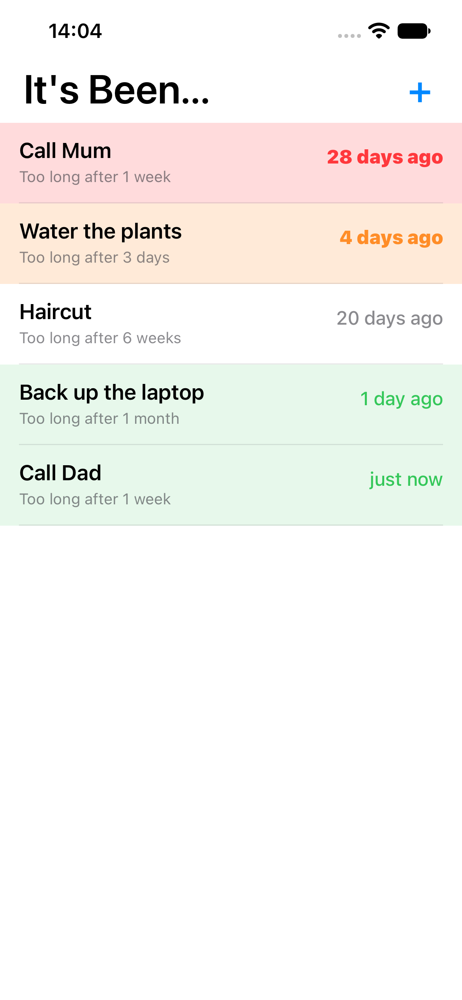

# It's Been...

An iPhone app, written in Common Lisp, for the things you mean to do every so
often: "Call Mum" shows *28 days ago*, and when you call her you reset it.

Each item has a title and a **Too long** time (a number of hours, days, weeks
or months). Rows are tinted by how far through that time they are:

| Colour | When |
|---|---|
| green | under a quarter of Too long since the last reset |
| plain | still within Too long |
| orange | past Too long, up to twice it |
| red | more than twice Too long |

The most overdue items are at the top. Tap a row to reset it ("Did it just
now"), see its history, or edit it; swipe left to delete; + adds one.

When an item goes past its Too long, a notification says so ("It's been
1 week since you last did this"), and again at twice and three times Too long,
then it stops. Opening one brings up that item's menu so it can be reset. The
app icon's badge counts the overdue items.

Every reset is remembered (the last 50), so the menu says how often you really
do it ("About every 8 days, over the last 5 times") and History lists when.

The list is kept in iCloud, so it is the same on every iPhone signed in to your
Apple Account and comes back if the app is deleted. Changes made on two phones
are merged item by item: resets from both are kept, the later edit wins, and a
delete sticks unless the item was reset or edited after it.

## Building

The core (`its-been.asd`, `src/core/`) is portable Common Lisp with FiveAM
tests. The app (`its-been-app.asd`, `src/ios/`) uses
[objc](https://github.com/lispnik/objc) for UIKit and is built by
[asdf-ios-app](https://github.com/lispnik/asdf-ios-app), which cross-compiles
with ECL.

    make deps       # ocicl install, here and in ../objc
    make test       # FiveAM suite in SBCL
    make test-ecl   # the same in host ECL
    make run-sim    # build, install and launch on the booted simulator
    make demo-sim   # with sample items in every colour
    make device     # needs IOS_SIGNING_IDENTITY etc. in local.mk
    make icon       # redraw res/Icon.xcassets from tools/icon.lisp

`ITS_BEEN_DEMO_SHOW=add|edit|menu|history` (as `SIMCTL_CHILD_...`) opens that screen
at launch, for screenshots without a finger, and `ITS_BEEN_DEMO_SOON=20` makes
a demo item go overdue, and notify, 20 seconds after launch. A demo launch asks
for notifications provisionally, so no permission prompt blocks it.

The list is saved in the app's Documents directory as `its-been.sexp`, and the
same text is kept in iCloud key-value storage. Only App Store builds sync: they
are signed with `res/distribution.entitlements`, whose iCloud entitlement needs
the App ID to have iCloud turned on and a profile made after that. Simulator
and development builds, and demo launches, keep the list on the device.
